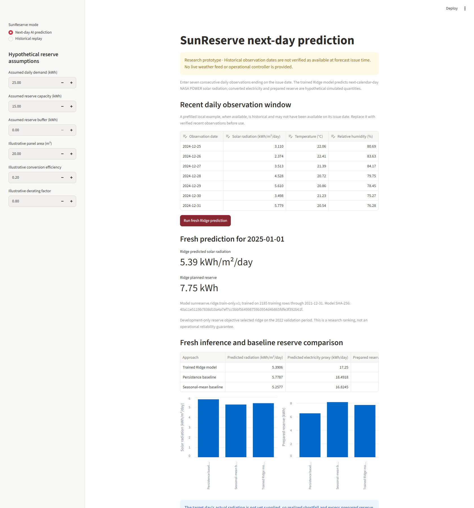
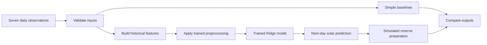
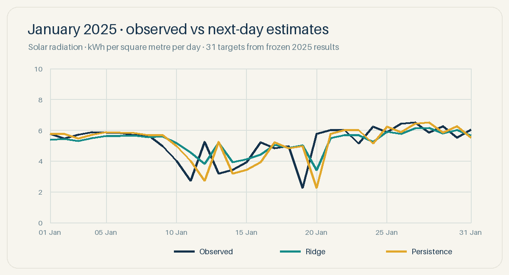
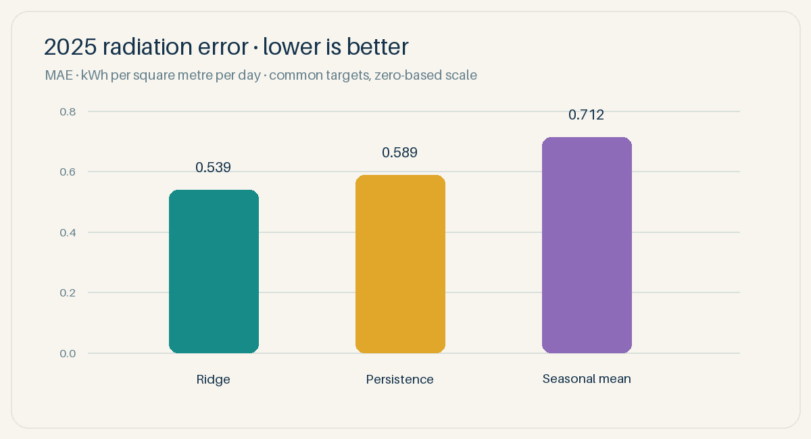
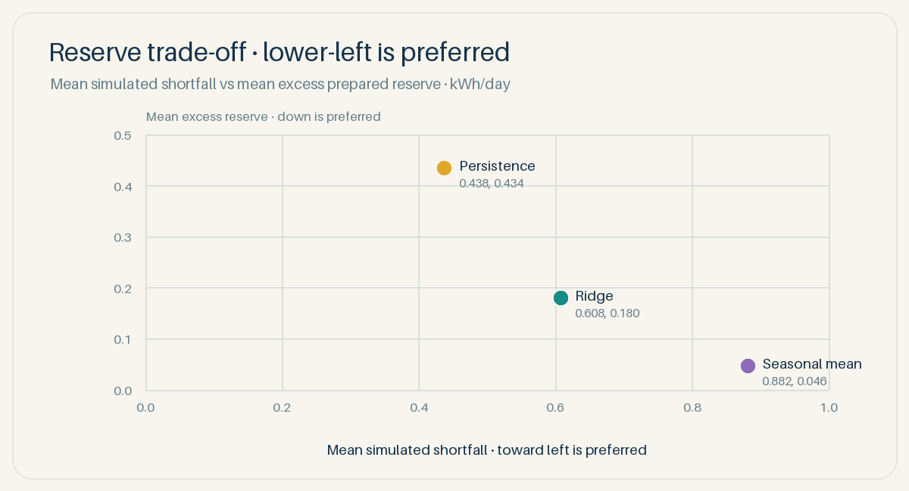

# SunReserve

<p align="center"></p>

SunReserve uses a trained solar-radiation model to explore tomorrow’s backup-energy needs.

  

<p align="center"></p>

This screenshot is a prior captured app state using its seven-day example and hypothetical 25 kWh daily demand. For 2025-01-01 it shows a fresh 5.39 kWh/m²/day Ridge estimate and 7.75 kWh planned reserve, alongside both baselines. The NASA POWER input dates are not verified as available on issue day; reserve is simulated. Current visual/mobile acceptance is not claimed by this image.

## The problem

A facilities manager at a hypothetical Bengaluru school must plan backup energy for tomorrow while solar contribution is uncertain: too little reserve may leave demand unmet, while too much may waste capacity. SunReserve asks whether a next-day solar-radiation estimate changes this simulated decision compared with yesterday’s reading or a training-only seasonal mean. This historical research prototype uses NASA POWER gridded estimates, not school rooftop measurements; its demand and system settings are hypothetical and do not establish an operating school system.

## The AI pipeline



Ridge applies training-fitted median imputation and scaling. Persistence carries forward the latest reading; the seasonal baseline uses training-only monthly means. Prediction mode compares the forecasts and planned reserves under one assumption set. Since tomorrow’s actual is unknown, it reports no realized shortfall or excess.

## Frozen 2025 results

This frozen replay scores 365 common targets in 2025. Ridge was trained on 2,185 rows through 2021 and selected only on 2022 validation data. Earlier dates provide features; 2023–2024 targets are not scored. Each plot is generated from the committed result CSVs.

January’s observed NASA POWER radiation is plotted against Ridge and persistence predictions. The dates shown are target dates, not evidence that observations were available when their simulated forecasts were issued.

<p align="center"></p>

The full-year forecast comparison uses mean absolute error (MAE), in kWh/m²/day, on identical target dates. The vertical axis starts at zero to make the bar lengths comparable.

<p align="center"></p>

| Approach | Radiation MAE (kWh/m²/day) | Mean simulated shortfall (kWh/day) | Mean excess prepared reserve (kWh/day) | Equal-weight score (kWh/day) |
| --- | ---: | ---: | ---: | ---: |
| Ridge | 0.5388 | 0.607825 | 0.179572 | 0.787398 |
| Persistence | 0.5886 | 0.437777 | 0.433656 | 0.871433 |
| Training-only seasonal mean | 0.7119 | 0.881887 | 0.045961 | 0.927848 |

Scenario settings are assumptions: 15 kWh daily demand and capacity, 20 m² panels, 0.20 efficiency, 0.80 derating, and zero buffer. The scatter shows mean shortfall and excess reserve; left means less shortfall, down less excess. Ridge's shortfall exceeds persistence's (0.607825 versus 0.437777 kWh/day), while its excess is lower.

<p align="center"></p>

The hypothetical equal-weight score adds mean shortfall and excess reserve at 1:1 weights. Ridge scores 0.787398 kWh/day versus 0.871433 for persistence and 0.927848 for seasonal mean. This research ranking is not a price, reliability target, operating recommendation, savings, or causal effect.

## Quick start

Python 3.11–3.13 is supported. From a fresh checkout, install the project and its verification tools, then launch the app. The tracked model and data artifacts let the demonstration start without downloading data or fitting a model. The preview command runs headlessly, disables usage statistics, and binds only to the local machine.

```powershell
python -m venv .venv
& .\.venv\Scripts\python.exe -m pip install -e ".[dev]"
& .\.venv\Scripts\python.exe -m streamlit run app.py --server.headless true --server.address 127.0.0.1 --browser.gatherUsageStats false
```

The default view is **Next-day AI prediction**. Confirm or replace the seven daily rows and choose **Run fresh Ridge prediction**. The separate replay view reads its saved historical artifacts. Neither mode contacts NASA POWER at startup. To refresh source data explicitly, follow the fetch, prepare, and validation procedure in the [method and results write-up](docs/writeup.md).

The [tested environment snapshot](docs/environment-snapshot.md) records one exact Windows/Python resolution separately from the supported compatibility ranges. [Dependency security guidance](docs/dependency-security.md) explains the vulnerability scan and review process.

## Limitations

- **Latency:** NASA POWER solar values are historical estimates with reported latency of about 5–7 days, so they are not verified next-day inputs.
- **Hypothetical school/system:** Demand, panel area, efficiency, derating, capacity, and buffer are assumptions rather than facility measurements.
- **Simplified conversion:** Radiation becomes an electricity proxy without hourly generation, storage state, outages, or dispatch behavior.
- **No field validation:** The prototype has not been evaluated against a school's meter, rooftop system, or operating reserve decisions.

## Reproduce and inspect

The frozen 2025 predictions, decision metrics, manifests, and descriptive report are in [`artifacts/runs/frozen-test-2025/`](artifacts/runs/frozen-test-2025/). Regenerate the README PNGs from those CSV files with the script below; it validates the target dates and derives the MAE and reserve comparison values from the source rows.

```powershell
& .\.venv\Scripts\python.exe scripts\generate_readme_charts.py
```

For split design, baselines, and interpretation, read the [method and results](docs/writeup.md), [data provenance](docs/data_sources.md), [reserve assumptions](docs/assumptions.md), and [AI credits](#credits). The [implementation plan](docs/implementation_plan.md) records the scope and verification history. The source is the NASA POWER Daily API; these plots use gridded radiation estimates, not measured school generation.

## Credits

Luna implemented the project and visuals; Codex planned and independently reviewed it; Jev supplied advisory reviews. Python, pandas, NumPy, scikit-learn, Streamlit, and Pillow support the model and figures. The app runs locally; no hosted service or field deployment is claimed.
